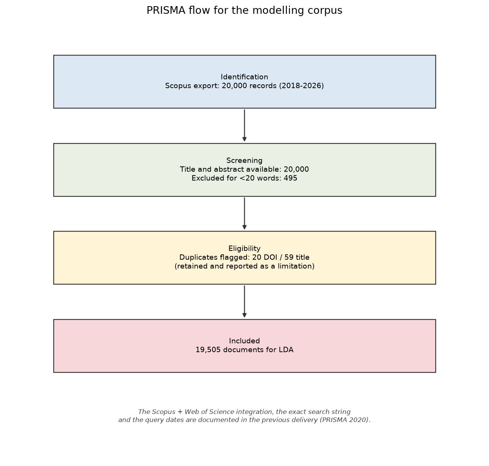
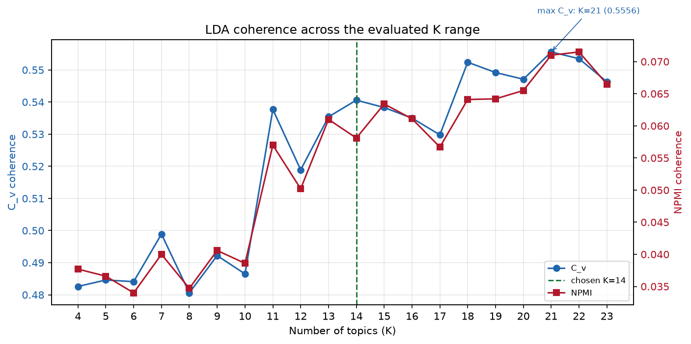
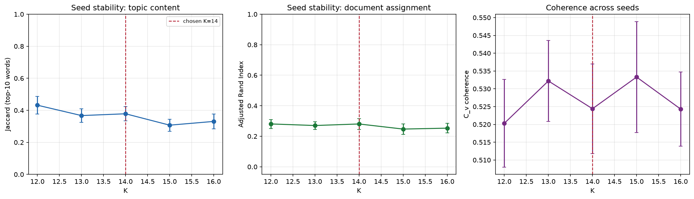
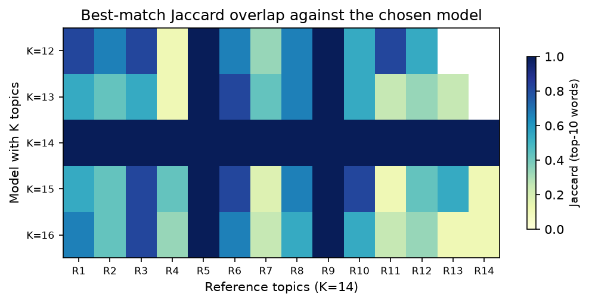
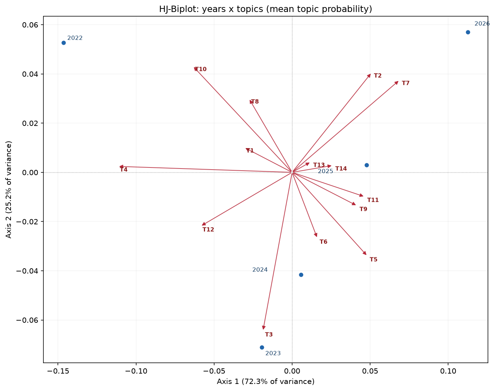
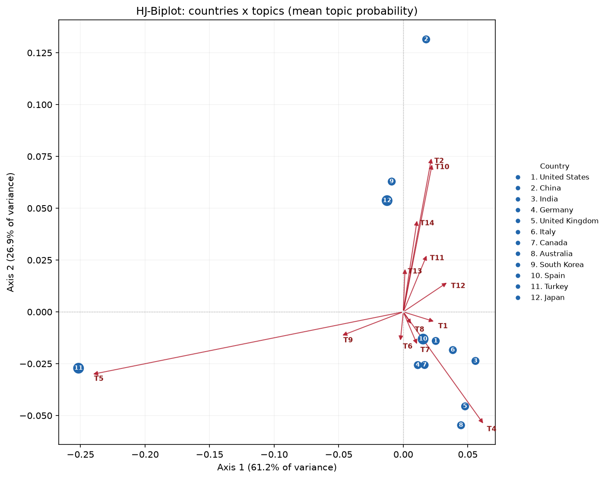
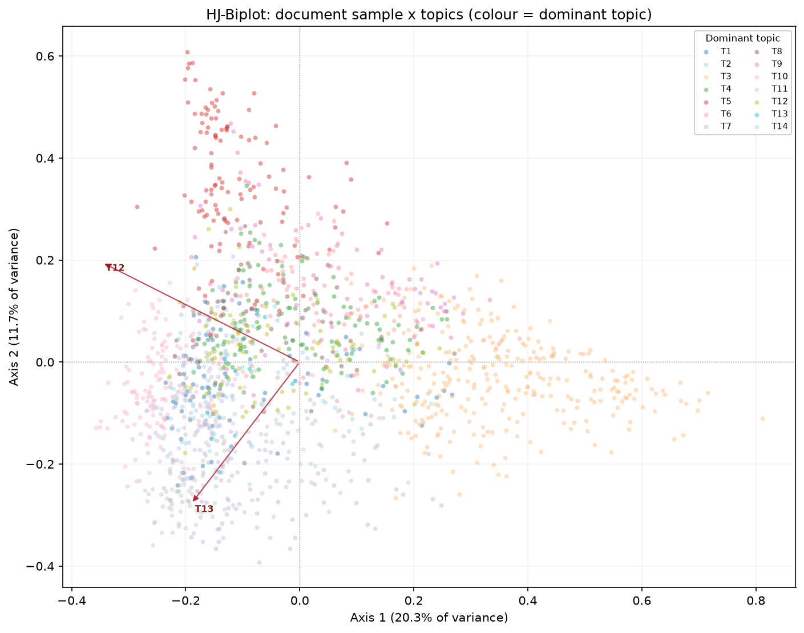
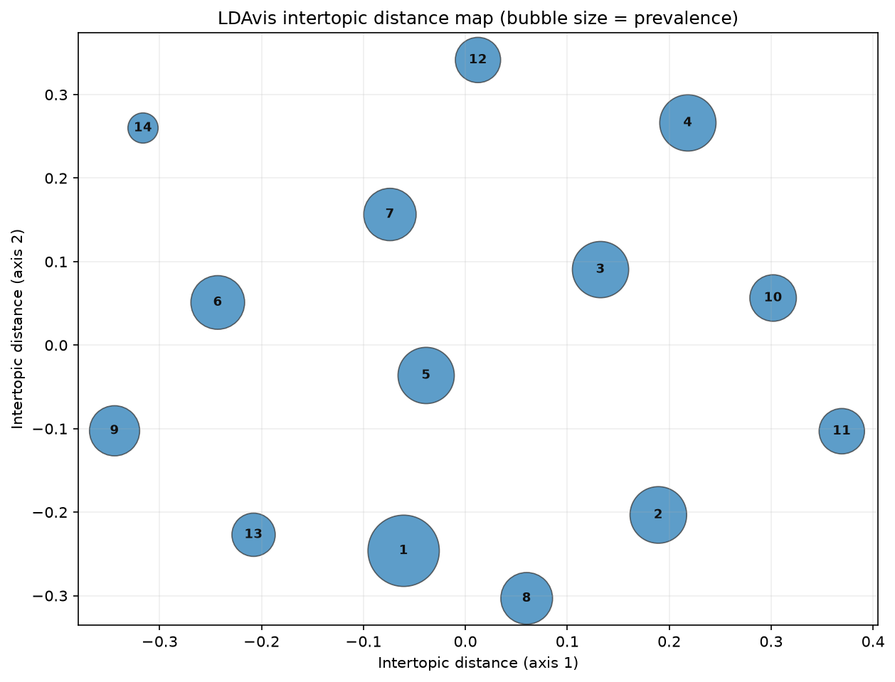
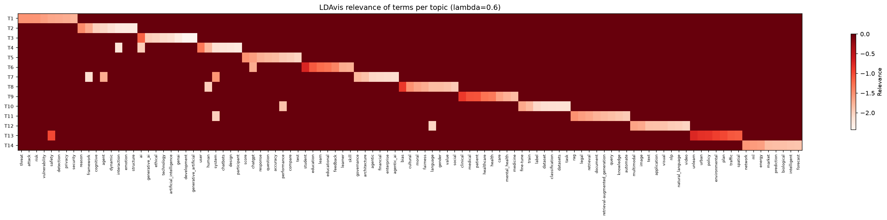

# Metodología y resultados preliminares — Modelado de tópicos con LDA

**Corpus:** ética de la inteligencia artificial, IA generativa y grandes modelos de lenguaje (Scopus, 2018–2026)  
**Documento generado:** 2026-11-08 00:28  
**Repositorio:** `https://github.com/JeanVydes/bertlda`  
**Configuración completa exportada:** `outputs/results/config/model_configuration_full.json`

> **Nota de alcance.** Este documento integra la metodología y los resultados
> preliminares del modelo LDA. La entrega anterior (PRISMA, integración
> Scopus + Web of Science) se retoma en la sección 1; el corpus de modelado
> disponible en este repositorio es el export de Scopus de 20,000 registros.
> Los campos marcados como `[COMPLETAR]` deben tomarse de la Entrega 1 para la
> versión final.

---

## 1. Recolección y depuración del corpus

### 1.1 Fuentes consultadas y ecuación de búsqueda

La revisión sistemática de la Entrega 1 combinó registros de **Scopus** y
**Web of Science (WoS)**. El corpus consolidado se orientó a la intersección
entre inteligencia artificial, IA generativa, grandes modelos de lenguaje y
sus dimensiones éticas, sociales, regulatorias y de seguridad. La ecuación
exacta de búsqueda, las fechas de consulta y los conteos de la integración
WoS se documentan en la Entrega 1:

- **Ecuación de búsqueda Scopus:** `[COMPLETAR con la cadena exacta de la Entrega 1]`
- **Ecuación de búsqueda WoS:** `[COMPLETAR con la cadena exacta de la Entrega 1]`
- **Fecha de consulta Scopus:** `[COMPLETAR]`
- **Fecha de consulta WoS:** `[COMPLETAR]`
- **Registros WoS integrados:** `[COMPLETAR]`
- **Duplicados eliminados en la integración:** `[COMPLETAR]`

El export utilizado en esta entrega contiene **20,000 registros de Scopus**
(campo `Source = Scopus`), con título, resumen, palabras clave, año, fuente,
afiliaciones, país de afiliación, tipo de documento y DOI. La ventana temporal
observada es **2018-2026**; el año 2026 está
incompleto porque el export se realizó durante ese año.

### 1.2 Proceso PRISMA

El proceso PRISMA 2020 (Page et al., 2021) se resume a continuación para el
corpus de modelado. Los conteos de la integración Scopus + WoS de la Entrega 1
deben verificarse antes de la versión final.

| Metric | Value |
|---|---|
| Total records | 20000 |
| With title | 20000 |
| With abstract | 20000 |
| With both | 20000 |
| Without useful text | 0 |
| DOI duplicates | 20 |
| Title duplicates | 59 |
| Excluded by length | 495 |
| USABLE DOCUMENTS | 19505 |
| Year range | 2018-2026 |
| Countries (normalized) | 86 |
| Corpus ALL CAPS | 0.0% |
| Uppercase normalization | False |
| Docs >350 words | 739 |
| Distinct sources | 5697 |

- **Registros identificados (Scopus):** 20,000
- **Registros sin título o resumen:** 0
- **Excluidos por longitud (< 20 palabras):** 495
- **Duplicados detectados:** 20 por DOI y 59 por título (se conservan y se reportan como limitación)
- **Documentos finales para LDA:** **19,505**
- **Países normalizados:** 86
- **Fuentes distintas:** 5,697

### 1.3 Diagrama de flujo PRISMA



El diagrama completo de la integración Scopus + WoS se conserva en la Entrega 1.
El diagrama anterior documenta el flujo del corpus efectivamente modelado.

### 1.4 Corpus final

El corpus final contiene **19,505 documentos** con texto suficiente para el
modelado. La distribución anual muestra una concentración muy fuerte en los
últimos años, coherente con el auge de la IA generativa:

| Year | Documents | % |
|---|---|---|
| 2018 | 2 | 0.0100 |
| 2019 | 1 | 0.0100 |
| 2021 | 1 | 0.0100 |
| 2022 | 31 | 0.1600 |
| 2023 | 556 | 2.8500 |
| 2024 | 2763 | 14.1700 |
| 2025 | 6883 | 35.2900 |
| 2026 | 9268 | 47.5200 |

---

## 2. Preprocesamiento del texto

### 2.1 Campos utilizados

Se utilizaron **título** y **resumen** (`Title` + `Abstract`). Las palabras clave
de autor e índice (`Author Keywords`, `Index Keywords`) están disponibles en el
export, pero no se concatenaron al texto de entrada para evitar duplicar
términos y para mantener una representación homogénea entre documentos.

### 2.2 Técnicas aplicadas

1. **Normalización Unicode y minúsculas.**
2. **Eliminación de ruido editorial:** URLs, correos, citas numéricas,
   avisos de copyright, licencias y frases de “publicado por”.
3. **Tokenización** por espacios sobre texto limpio.
4. **Lematización con WordNet** (primero sustantivos, luego verbos).
5. **Eliminación de stopwords en cuatro capas:**
   - stopwords funcionales del inglés (NLTK);
   - stopwords editoriales (Elsevier, Springer, MDPI, “journal”, “abstract”, etc.);
   - stopwords metodológicas (“study”, “results”, “method”, “approach”, etc.);
   - términos de dominio de ética de la IA y acrónimos válidos.
6. **Filtrado por longitud:** se descartan tokens de menos de 3 caracteres,
   salvo acrónimos válidos (`ai`, `llm`, `gpt`, `nlp`, `gdpr`, etc.).
7. **Bigramas:** se detectan colocaciones con `gensim.models.phrases`
   (`min_count=59`,
   `threshold=8`), por ejemplo
   `generative_ai`, `artificial_intelligence`, `machine_learning`.
8. **Filtrado de vocabulario:** el diccionario de entrenamiento elimina términos
   con frecuencia documental menor que `39` y
   presentes en más del `0.5` de los documentos.
9. **Sin stemming agresivo:** se prefiere la lematización para preservar la
   interpretabilidad de los tópicos.

### 2.3 Herramientas

- **Python 3.13** y **NLTK** para tokenización, stopwords y lematización.
- **Gensim 4.4** para bigramas, diccionario, corpus BoW y LDA.
- **pandas / NumPy** para la manipulación de datos.
- **Matplotlib** para las figuras.

### 2.4 Resultados del preprocesamiento

| Indicador | Valor |
|---|---:|
| Documentos modelados | 19,505 |
| Tokens totales | 2,361,836 |
| Tokens por documento (media) | 121.09 |
| Vocabulario de entrenamiento | 4,533 |
| Vocabulario de evaluación | 23,887 |
| Documentos con BoW vacío | 0 |
| Stopwords totales | 288 |

La limpieza se implementó en `src/bertlda/text_processing.py` y se aplicó de
forma determinista en `src/bertlda/phase1a_lda_diagnostic.py`.

---

## 3. Fundamento del modelo LDA

Latent Dirichlet Allocation (Blei, Ng & Jordan, 2003) es un modelo generativo
jerárquico para colecciones de documentos discretos. Cada documento se
representa como una mezcla de un número fijo de tópicos y cada tópico como una
distribución sobre el vocabulario. Formalmente, para un documento $d$:

$$
\theta_d \sim \mathrm{Dirichlet}(\alpha), \qquad
z_{d,n} \sim \mathrm{Categorical}(\theta_d), \qquad
w_{d,n} \sim \mathrm{Categorical}(\phi_{z_{d,n}}),
$$

donde $\theta_d$ es la proporción de tópicos del documento, $z_{d,n}$ es el
tópico latente de la palabra $n$ y $\phi_k \sim \mathrm{Dirichlet}(\eta)$ es
la distribución de palabras del tópico $k$. La verosimilitud conjunta integra
las variables latentes y se aproxima mediante inferencia variacional o
muestreo de Gibbs; Gensim utiliza inferencia variacional en línea.

LDA es apropiado para este corpus porque:

- los documentos son textos cortos y heterogéneos (título + resumen), donde un
  modelo probabilístico de mezclas es más estable que un clustering duro;
- el objetivo es **describir** la estructura temática y su evolución, no
  clasificar documentos en categorías predefinidas;
- la matriz documento-tópico ($\Theta$) permite análisis posteriores con
  HJ-Biplot, LDAvis y modelos de tendencia;
- la literatura de ética de la IA es interdisciplinaria: un mismo documento
  puede combinar gobernanza, sesgo, privacidad y evaluación técnica, lo que
  favorece una representación mixta.

---

## 4. Selección del número de tópicos (K)

### 4.1 Métricas de coherencia

Se evaluaron dos métricas complementarias:

- **C_v** (Röder, Both & Hinneburg, 2015): combina similitud semántica entre
  palabras, ventana deslizante y confirmación mutua; es la métrica de referencia
  para comparar tópicos en corpus científicos.
- **NPMI** (Bouma, 2009): información mutua puntual normalizada; penaliza
  asociaciones espurias y es fácilmente interpretable en el rango [-1, 1].

También se registraron **diversidad de tópicos** (proporción de palabras únicas
en el top-10 de todos los tópicos), **perplejidad**, **dominancia** (cuota del
tópico más frecuente) y **entropía normalizada** de la distribución de tamaños.

### 4.2 Rango evaluado y criterio de decisión

Se evaluó **K = 4–23** (20 valores).
La curva de coherencia muestra un máximo global en **K = 21**
(C_v = 0.5556), pero la ganancia respecto de K = 14 es marginal
(+0.0150) y se concentra en la zona de meseta
K ≈ 14–23. Se seleccionó **K = 14** por las siguientes razones:

1. **Meseta de coherencia:** K = 14 ya se encuentra en la meseta
   (C_v = 0.5406; NPMI = +0.0581).
2. **Parsimonia e interpretabilidad:** 14 tópicos producen una estructura
   temática manejable y alineada con las dimensiones de la ética de la IA
   (seguridad, sesgo, gobernanza, educación, salud, etc.).
3. **Diversidad:** la diversidad del top-10 es 0.8000, alta para el
   tamaño del corpus.
4. **Dominancia:** el tópico más frecuente concentra 17.7%
   de los documentos, por debajo del umbral de dominancia excesiva (40%).
5. **Estabilidad:** el análisis de sensibilidad (sección 6) confirma que la
   estructura de K = 14 es comparable a la de sus vecinos.



### 4.3 Tabla completa de la búsqueda de K

| K | C_v | NPMI | Diversity | Perplexity | Dominance | Entropy | Empty topics |
|---|---|---|---|---|---|---|---|
| 4 | 0.4826 | 0.0377 | 0.8750 | -7.4130 | 0.2740 | 0.9953 | 0.0000 |
| 5 | 0.4846 | 0.0366 | 0.8200 | -7.3861 | 0.2516 | 0.9891 | 0.0000 |
| 6 | 0.4841 | 0.0340 | 0.7500 | -7.3658 | 0.2298 | 0.9882 | 0.0000 |
| 7 | 0.4989 | 0.0400 | 0.7429 | -7.3513 | 0.2060 | 0.9864 | 0.0000 |
| 8 | 0.4806 | 0.0347 | 0.7125 | -7.3453 | 0.1863 | 0.9894 | 0.0000 |
| 9 | 0.4922 | 0.0406 | 0.7444 | -7.3327 | 0.1491 | 0.9917 | 0.0000 |
| 10 | 0.4865 | 0.0386 | 0.7000 | -7.3298 | 0.1390 | 0.9884 | 0.0000 |
| 11 | 0.5377 | 0.0570 | 0.8091 | -7.3059 | 0.1288 | 0.9860 | 0.0000 |
| 12 | 0.5189 | 0.0502 | 0.7750 | -7.3105 | 0.1518 | 0.9818 | 0.0000 |
| 13 | 0.5354 | 0.0610 | 0.7769 | -7.3168 | 0.1238 | 0.9689 | 0.0000 |
| 14 | 0.5406 | 0.0581 | 0.8000 | -7.3209 | 0.1774 | 0.9542 | 0.0000 |
| 15 | 0.5383 | 0.0634 | 0.7467 | -7.3229 | 0.1963 | 0.9564 | 0.0000 |
| 16 | 0.5350 | 0.0611 | 0.7688 | -7.3216 | 0.1148 | 0.9638 | 0.0000 |
| 17 | 0.5298 | 0.0567 | 0.7588 | -7.3233 | 0.1171 | 0.9573 | 0.0000 |
| 18 | 0.5524 | 0.0641 | 0.7778 | -7.3192 | 0.1360 | 0.9524 | 0.0000 |
| 19 | 0.5492 | 0.0642 | 0.8000 | -7.3205 | 0.1566 | 0.9499 | 0.0000 |
| 20 | 0.5471 | 0.0655 | 0.7450 | -7.3280 | 0.1346 | 0.9500 | 0.0000 |
| 21 | 0.5556 | 0.0710 | 0.7952 | -7.3287 | 0.1251 | 0.9556 | 0.0000 |
| 22 | 0.5535 | 0.0715 | 0.7818 | -7.3270 | 0.1247 | 0.9444 | 0.0000 |
| 23 | 0.5463 | 0.0665 | 0.7826 | -7.3371 | 0.1059 | 0.9505 | 0.0000 |

---

## 5. Configuración y ejecución del modelo

### 5.1 Librería y software

- **Gensim 4.4.0**, implementación `LdaModel` en un solo proceso.
- **Python 3.13**; el entorno se reproduce con `uv sync`.
- Semilla global **42**.
- Exportaciones exclusivamente en **CSV** (nunca xlsx); los checkpoints
  intermedios usan `.pkl`.

### 5.2 Hiperparámetros

| Parámetro | Valor |
|---|---|
| Número de tópicos (K) | 14 |
| Alpha (prior documento-tópico) | `asymmetric` |
| Eta / beta (prior tópico-palabra) | `symmetric` |
| Iteraciones (passes) | 50 |
| Iteraciones internas por documento | 50 |
| Semilla aleatoria | 42 |
| Documentos | 19,505 |
| Vocabulario | 4,533 |
| Implementación | `gensim.models.ldamodel.LdaModel` |

La búsqueda de alpha/eta evaluó **16 combinaciones** (4 valores de
alpha × 4 de eta). La mejor combinación fue
**alpha = `asymmetric`, eta = `symmetric`** (C_v = 0.5039).
Las 8 mejores combinaciones se muestran a continuación:

| alpha | eta | C_v | NPMI | Dominance |
|---|---|---|---|---|
| asymmetric | symmetric | 0.5039 | 0.0474 | 0.1136 |
| asymmetric | 0.05 | 0.5006 | 0.0459 | 0.1147 |
| asymmetric | 0.01 | 0.5002 | 0.0458 | 0.1158 |
| asymmetric | 0.5 | 0.5000 | 0.0464 | 0.1115 |
| symmetric | 0.05 | 0.4988 | 0.0453 | 0.1156 |
| symmetric | symmetric | 0.4988 | 0.0453 | 0.1155 |
| 0.1 | symmetric | 0.4988 | 0.0453 | 0.1150 |
| 0.01 | 0.01 | 0.4986 | 0.0455 | 0.1174 |

### 5.3 Reproducibilidad

El código completo está en `src/bertlda/`. La secuencia es:

```bash
uv sync
uv run python src/bertlda/preprocess_corpus.py
uv run python src/bertlda/phase0_audit.py
uv run python src/bertlda/phase1a_lda_diagnostic.py
uv run python src/bertlda/phase1b_lda_decision.py
uv run python src/bertlda/phase1c_lda_final.py
uv run python src/bertlda/phase5_sensitivity.py
uv run python src/bertlda/phase6_report.py
```

La configuración completa, las versiones de las librerías, las métricas y el
inventario de artefactos se exportan en
`outputs/results/config/model_configuration_full.json`.

### 5.4 Métricas del modelo final

| Métrica | Valor |
|---|---:|
| C_v | 0.5249 |
| NPMI | +0.0518 |
| Diversidad (top-10) | 0.7929 |
| Perplejidad | -7.3229 |
| Dominancia | 0.1824 |
| Entropía normalizada | 0.9497 |
| Tópicos vacíos | 0 |

> **Nota sobre la comparación de C_v.** La grilla de K (sección 4) usa
> `alpha="symmetric"` y `passes=30`; el modelo final usa
> `alpha="asymmetric"`, `eta="symmetric"` y `passes=50`.
> Por eso su C_v (0.5249) no coincide exactamente
> con el valor de la grilla para K = 14 (0.5406). La comparación
> válida es dentro de cada configuración.

---

## 6. Análisis de sensibilidad del modelo

El análisis de sensibilidad evalúa tres fuentes de variación: **semilla
aleatoria**, **vecindario de K** y **hiperparámetros alpha/eta**. Para comparar
corridas se usan dos métricas:

- **Jaccard** entre las 10 palabras principales de tópicos alineados. La
  alineación se resuelve con el algoritmo húngaro sobre la similitud coseno
  entre las distribuciones tópico-palabra.
- **Adjusted Rand Index (ARI)** entre las asignaciones del tópico dominante de
  cada documento.

### 6.1 Estabilidad ante la semilla aleatoria

Se entrenaron **5 semillas**
(42, 43, 44, 45, 46) para cada
K ∈ [12, 13, 14, 15, 16], con `passes=10`.
La tabla siguiente reporta la media y la desviación estándar sobre todos los
pares de semillas:

| K | Jaccard mean | Jaccard SD | Jaccard min | ARI mean | ARI SD | ARI min | C_v mean | C_v SD |
|---|---|---|---|---|---|---|---|---|
| 12 | 0.4321 | 0.0544 | 0.3557 | 0.2808 | 0.0292 | 0.2412 | 0.5203 | 0.0123 |
| 13 | 0.3673 | 0.0427 | 0.3008 | 0.2705 | 0.0256 | 0.2216 | 0.5322 | 0.0114 |
| 14 | 0.3785 | 0.0444 | 0.2915 | 0.2806 | 0.0358 | 0.2141 | 0.5244 | 0.0126 |
| 15 | 0.3074 | 0.0376 | 0.2565 | 0.2472 | 0.0346 | 0.2221 | 0.5333 | 0.0156 |
| 16 | 0.3308 | 0.0461 | 0.2468 | 0.2532 | 0.0316 | 0.2097 | 0.5243 | 0.0104 |

La tabla anterior resume la estabilidad entre semillas para cada valor de K del vecindario. El Jaccard se calcula sobre las 10 palabras principales de tópicos alineados con el algoritmo húngaro; el ARI se calcula sobre la asignación del tópico dominante de cada documento.



### 6.2 Estabilidad ante variaciones de K

La tabla siguiente compara cada modelo del vecindario con el modelo de
referencia (K = 14, semilla 42). `Best Jaccard` es el mejor
solapamiento de cada tópico del modelo con un tópico de referencia; la última
columna indica cuántos tópicos de referencia quedan cubiertos con Jaccard ≥ 0.5.

| K | Best Jaccard mean | Median | Min | Max | Topics ≥ 0.5 | Topics | Reference topics covered ≥ 0.5 |
|---|---|---|---|---|---|---|---|
| 12 | 0.6647 | 0.6667 | 0.1111 | 1 | 10 | 12 | 10 |
| 13 | 0.5309 | 0.5385 | 0.1111 | 1 | 7 | 13 | 7 |
| 14 | 1 | 1 | 1 | 1 | 14 | 14 | 14 |
| 15 | 0.5255 | 0.5385 | 0.0000 | 1 | 8 | 15 | 8 |
| 16 | 0.4404 | 0.3810 | 0.0000 | 1 | 7 | 16 | 7 |



### 6.3 Sensibilidad a alpha y eta

La grilla de **16 combinaciones** muestra que las diferencias de C_v
entre configuraciones son pequeñas (rango
0.0124). La configuración elegida
(`alpha=asymmetric`, `eta=symmetric`) se mantiene entre las mejores y
produce la mayor coherencia. Esto sugiere que la estructura temática es
razonablemente robusta a la elección de priors, siempre que se mantenga un
alpha asimétrico o cercano a la simetría.

### 6.4 Conclusión sobre robustez

Para el K elegido (14) la estabilidad entre semillas es **moderada**: Jaccard medio 0.3785 (SD 0.0444, mínimo 0.2915) y ARI medio 0.2806 (SD 0.0358, mínimo 0.2141). Los tópicos con mayor volumen (T3, T10, T4, T11) se recuperan de forma más consistente, mientras que los tópicos pequeños (T13) son más sensibles. La estructura de 14 tópicos se considera **suficientemente robusta para un análisis exploratorio**, con la recomendación de reportar los tópicos de baja frecuencia como provisionales. Este resultado es consistente con la literatura sobre estabilidad en topic models (Greene, O'Callaghan & Cunningham, 2014; De Waal & Barnard, 2008; Koltcov, Koltsova & Nikolenko, 2014).

---

## 7. Métodos Biplot y LDAvis

### 7.1 HJ-Biplot

El **HJ-Biplot** (Galindo-Villardón, 1986), extensión del biplot de Gabriel
(1971), representa simultáneamente filas y columnas de una matriz mediante una
descomposición en valores singulares. Para una matriz centrada $X$:

$$
X = U D V^\top,
$$

las coordenadas de filas son $A = U D$ y las de columnas $B = V D$. La
propiedad clave es que el producto escalar $a_i \cdot b_j$ aproxima el valor
$x_{ij}$, de modo que filas y columnas se interpretan en el mismo espacio. La
**calidad de representación** de cada marcador se mide con el coseno al
cuadrado:

$$
\cos^2_{i} = \frac{a_{i1}^2 + a_{i2}^2}{\sum_k a_{ik}^2},
$$

y de forma análoga para las columnas. La **calidad global** es el promedio de
los cosenos al cuadrado. Se construyeron tres biplots:

1. **Años × tópicos:** cada fila es un año (con al menos 20 documentos) y cada
   columna un tópico; el valor es la probabilidad media del tópico en ese año.
2. **Países × tópicos:** cada fila es uno de los 12 países con más documentos;
   el valor es la probabilidad media del tópico.
3. **Documentos × tópicos:** muestra aleatoria de 1500
   documentos, coloreada por tópico dominante.

| Dataset | Rows | Columns | Axis 1 (%) | Axis 2 (%) | Mean row cos² | Mean column cos² |
|---|---|---|---|---|---|---|
| Years x topics | 5 | 14 | 72.3300 | 25.1500 | 0.9237 | 0.9646 |
| Countries x topics | 12 | 14 | 61.2000 | 26.8900 | 0.6774 | 0.6355 |
| Document sample x topics | 1500 | 14 | 20.2900 | 11.7200 | 0.3113 | 0.2109 |







**Lectura.** En el biplot de años, la cercanía entre un año y un tópico indica
que ese tópico gana peso relativo en ese año; los años recientes (2024–2026)
se desplazan hacia los tópicos de IA generativa, agentes y evaluación de
modelos. En el biplot de países, los países se identifican con un número y la
leyenda lateral; la posición de cada país resume su perfil temático medio:
países con alta producción en IA aplicada se acercan a los tópicos de sistemas
y aplicaciones, mientras que los países con producción más orientada a
gobernanza se acercan a los tópicos de ética y política. La calidad media de
representación (cos²) indica cuánta de la variación de cada marcador queda
capturada por los dos ejes; valores altos (> 0.7) permiten interpretar con
confianza la posición de ese marcador.

### 7.2 LDAvis

LDAvis (Sievert & Shirley, 2014) combina dos vistas:

- **Mapa de distancia intertópica:** los tópicos se proyectan en dos
  dimensiones a partir de la distancia entre sus distribuciones de palabras.
  El tamaño de cada burbuja es proporcional a la **prevalencia** del tópico en
  el corpus. Tópicos cercanos comparten vocabulario y pueden solaparse.
- **Ranking de términos relevantes:** para cada tópico se ordenan las palabras
  por **relevancia**:

$$
\mathrm{relevance}(w \mid t) = \lambda \, p(w \mid t)
+ (1-\lambda) \, \frac{p(w \mid t)}{p(w)},
$$

  donde $\lambda \in [0,1]$ controla el peso de la frecuencia condicional
  frente a la exclusividad del término. Se usó **λ = 0.6** (valor
  recomendado por Sievert & Shirley para exploración), y se exportaron también
  los rankings para λ = 0 y λ = 1.





El visor interactivo completo está en
[`outputs/visualizations/LDAvis.html`](../outputs/visualizations/LDAvis.html).

**Ranking de términos relevantes (λ = 0.6):**

| Topic | Term | Relevance (λ=0.6) |
|---|---|---|
| 1 | threat | -1.5314 |
| 1 | attack | -1.5339 |
| 1 | risk | -1.5447 |
| 1 | vulnerability | -1.6186 |
| 1 | safety | -1.6776 |
| 1 | detection | -1.6955 |
| 2 | reason | -1.4546 |
| 2 | framework | -1.6932 |
| 2 | cognitive | -1.9913 |
| 2 | agent | -2.0507 |
| 2 | dynamic | -2.1526 |
| 2 | interaction | -2.2510 |
| 3 | ai | -1.1649 |
| 3 | generative_ai | -1.9799 |
| 3 | ethical | -2.0215 |
| 3 | technology | -2.0804 |
| 3 | artificial_intelligence | -2.1238 |
| 3 | genai | -2.2855 |
| 4 | user | -1.3274 |
| 4 | human | -1.8089 |
| 4 | ai | -1.9765 |
| 4 | system | -2.1392 |
| 4 | chatbots | -2.1937 |
| 4 | interaction | -2.2010 |
| 5 | score | -1.5251 |
| 5 | chatgpt | -1.6044 |
| 5 | response | -1.7492 |
| 5 | question | -1.7982 |
| 5 | accuracy | -1.8294 |
| 5 | performance | -1.9337 |
| 6 | student | -0.7245 |
| 6 | education | -1.1052 |
| 6 | learn | -1.2418 |
| 6 | educational | -1.2950 |
| 6 | feedback | -1.4234 |
| 6 | learner | -1.7081 |
| 7 | system | -1.5446 |
| 7 | agent | -1.7277 |
| 7 | governance | -1.7959 |
| 7 | architecture | -1.8714 |
| 7 | agentic | -2.0518 |
| 7 | financial | -2.0743 |
| 8 | bias | -0.8739 |
| 8 | cultural | -1.5214 |
| 8 | moral | -1.6592 |
| 8 | fairness | -1.7271 |
| 8 | language | -1.8357 |
| 8 | gender | -1.8364 |
| 9 | clinical | -0.8877 |
| 9 | medical | -1.0558 |
| 9 | patient | -1.0668 |
| 9 | healthcare | -1.2840 |
| 9 | health | -1.3391 |
| 9 | care | -1.6335 |
| 10 | fine-tune | -1.6886 |
| 10 | train | -1.8042 |
| 10 | performance | -1.8848 |
| 10 | label | -2.0548 |
| 10 | dataset | -2.1195 |
| 10 | classification | -2.1266 |
| 11 | rag | -1.5160 |
| 11 | legal | -1.6052 |
| 11 | retrieval | -1.6675 |
| 11 | document | -1.7644 |
| 11 | retrieval-augmented_generation | -1.8039 |
| 11 | query | -1.8548 |
| 12 | multimodal | -1.6435 |
| 12 | image | -1.6949 |
| 12 | text | -1.8625 |
| 12 | application | -1.8789 |
| 12 | visual | -1.8940 |
| 12 | nlp | -1.9633 |
| 13 | unlearn | -0.7481 |
| 13 | urban | -0.8188 |
| 13 | policy | -0.8377 |
| 13 | environmental | -0.9349 |
| 13 | safety | -0.9882 |
| 13 | plan | -0.9921 |
| 14 | network | -1.5529 |
| 14 | ml | -1.5935 |
| 14 | energy | -1.6186 |
| 14 | market | -1.8352 |
| 14 | prediction | -1.8513 |
| 14 | biological | -1.8663 |

### 7.3 Comparación y complementariedad

El **HJ-Biplot** aporta una lectura multivariante y estructural: permite ver
cómo años, países y documentos se posicionan respecto de los tópicos, con una
medida explícita de calidad de representación (cos²). Es útil para responder
preguntas del tipo “¿qué tópicos caracterizan a los países con más producción?”
o “¿cómo cambia el perfil temático entre años?”.

**LDAvis** aporta una lectura término-tópico: muestra qué palabras definen cada
tópico, cómo se solapan los tópicos y cuáles son los términos más relevantes
para un λ dado. Es útil para **interpretar y etiquetar** los tópicos, y para
detectar tópicos redundantes.

Los dos métodos son complementarios: el biplot dice **dónde** se ubican los
documentos, años y países en el espacio temático; LDAvis dice **por qué** un
tópico se interpreta de una manera, a partir de sus términos. La convergencia
entre ambos —tópicos cercanos en LDAvis que también aparecen próximos en el
biplot— refuerza la validez de la estructura temática.

---

## 8. Resultados preliminares y su interpretación

### 8.1 Caracterización descriptiva del corpus

**Distribución temporal.** El corpus cubre 2018-2026,
con una explosión de publicaciones a partir de 2023:

| Year | Documents | % |
|---|---|---|
| 2018 | 2 | 0.0100 |
| 2019 | 1 | 0.0100 |
| 2021 | 1 | 0.0100 |
| 2022 | 31 | 0.1600 |
| 2023 | 556 | 2.8500 |
| 2024 | 2763 | 14.1700 |
| 2025 | 6883 | 35.2900 |
| 2026 | 9268 | 47.5200 |

**Principales fuentes/revistas.** La producción se concentra en actas de
conferencias de NLP/IA y en revistas de acceso abierto:

| Source | Documents | % |
|---|---|---|
| Proceedings of the Annual Meeting of the Association for Computational Linguistics | 542 | 2.7800 |
| Lecture Notes in Computer Science | 365 | 1.8700 |
| CEUR Workshop Proceedings | 281 | 1.4400 |
| Conference on Human Factors in Computing Systems - Proceedings  | 278 | 1.4300 |
| IEEE Access | 260 | 1.3300 |
| Advances in Neural Information Processing Systems | 232 | 1.1900 |
| Communications in Computer and Information Science | 218 | 1.1200 |
| Proceedings of Machine Learning Research | 179 | 0.9200 |
| Lecture Notes in Networks and Systems | 164 | 0.8400 |
| Applied Sciences (Switzerland) | 158 | 0.8100 |

**Países.** Estados Unidos y China concentran algo más de dos quintas partes
del corpus; la cola incluye India, Alemania, Reino Unido, Italia, Canadá y
Australia:

| Country | Documents | % |
|---|---|---|
| United States | 4538 | 23.7100 |
| China | 3888 | 20.3200 |
| India | 1022 | 5.3400 |
| Germany | 999 | 5.2200 |
| United Kingdom | 891 | 4.6600 |
| Italy | 617 | 3.2200 |
| Canada | 500 | 2.6100 |
| Australia | 487 | 2.5400 |
| South Korea | 449 | 2.3500 |
| Spain | 316 | 1.6500 |

**Tipos de documento.** Predominan artículos y ponencias de congreso, con una
presencia relevante de revisiones:

| Document type | Documents | % |
|---|---|---|
| Article | 8319 | 42.6500 |
| Conference paper | 8011 | 41.0700 |
| Review | 1806 | 9.2600 |
| Book chapter | 838 | 4.3000 |
| Note | 164 | 0.8400 |
| Book | 127 | 0.6500 |
| Editorial | 80 | 0.4100 |
| Letter | 53 | 0.2700 |
| Short survey | 47 | 0.2400 |
| Conference review | 42 | 0.2200 |

**Instituciones.** Las afiliaciones se extrajeron de la columna `Affiliations`
de Scopus. La tabla siguiente muestra las instituciones con más documentos:

| Institution | Documents | % |
|---|---|---|
| University of California | 354 | 1.8100 |
| Stanford University | 326 | 1.6700 |
| Tsinghua University | 322 | 1.6500 |
| Carnegie Mellon University | 255 | 1.3100 |
| Zhejiang University | 249 | 1.2800 |
| National University of Singapore | 239 | 1.2300 |
| Nanyang Technological University | 217 | 1.1100 |
| University of Oxford | 211 | 1.0800 |
| Shanghai Jiao Tong University | 203 | 1.0400 |
| University of Washington | 201 | 1.0300 |

**Panorama bibliométrico.** El corpus es reciente, dominado por conferencias y
revistas de IA/NLP, con una fuerte presencia de Estados Unidos y China. La
combinación de tipos de documento (artículos, ponencias, revisiones) sugiere
un campo en consolidación, con mucha producción aplicada y una capa creciente
de reflexión ética y regulatoria.

### 8.2 Resultados del modelo LDA

La tabla siguiente resume los 14 tópicos: identificador, etiqueta propuesta,
número de documentos con tópico dominante, términos principales y país con más
documentos en el tópico (por volumen).

| Topic | Proposed label | Documents | Top terms | Leading country |
|---|---|---|---|---|
| 1 | Adversarial attacks, privacy and cybersecurity | 1019 | risk, safety, detection, privacy, attack, security, threat, vulnerability, content, prompt | United States |
| 2 | Reasoning agents, alignment and cognitive frameworks | 1401 | framework, reason, agent, design, structure, interaction, evaluation, cognitive, system, dynamic | China |
| 3 | Generative AI ethics, governance and societal challenges | 3558 | ai, generative_ai, artificial_intelligence, technology, ethical, challenge, development, tool, genai, framework | United States |
| 4 | Human-AI interaction and conversational agents | 1722 | user, ai, human, system, design, interaction, make, work, chatbots, understand | United States |
| 5 | ChatGPT evaluation and benchmark performance | 1468 | chatgpt, score, response, performance, accuracy, question, compare, test, evaluation, quality | United States |
| 6 | AI in education and student learning | 1002 | student, learn, education, chatgpt, educational, feedback, tool, support, ai, skill | United States |
| 7 | Agentic systems, governance and enterprise deployment | 1462 | system, agent, framework, governance, architecture, ai, workflow, control, deployment, financial | United States |
| 8 | Bias, fairness, culture and language | 995 | bias, human, language, cultural, value, across, fairness, social, moral, prompt | United States |
| 9 | Clinical, medical and mental-health AI | 1091 | clinical, medical, patient, healthcare, health, support, include, care, application, ai | United States |
| 10 | Model training, fine-tuning and predictive performance | 1949 | performance, train, fine-tune, task, dataset, datasets, achieve, classification, feature, prompt | China |
| 11 | Retrieval-augmented generation and document automation | 1617 | system, rag, process, legal, knowledge, information, retrieval, automate, document, framework | China |
| 12 | Multimodal applications and natural-language tasks | 1245 | application, multimodal, task, text, challenge, image, language, include, natural_language, understand | China |
| 13 | Safety policy, machine unlearning and spatial/environmental applications | 153 | safety, policy, unlearn, plan, urban, environmental, construction, management, scenario, spatial | China |
| 14 | Neural networks, prediction and energy/market applications | 823 | network, prediction, system, intelligent, energy, ml, machine_learn, integrate, power, market | China |

**Lectura temática.** Los tópicos pueden agruparse en cuatro bloques:

1. **Riesgos y seguridad:** T1 (ataques adversarios, privacidad, ciberseguridad),
   T13 (política de seguridad, *machine unlearning*) y parte de T3.
2. **Gobernanza y ética:** T3 (IA generativa, ética, gobernanza), T8 (sesgo,
   equidad, cultura) y T7 (sistemas agénticos, auditoría, empresa).
3. **Aplicaciones y evaluación:** T5 (ChatGPT, benchmarks), T9 (salud clínica),
   T6 (educación), T10 (entrenamiento y *fine-tuning*), T11 (RAG y automatización
   documental), T12 (multimodalidad) y T14 (redes neuronales, energía).
4. **Interacción y agentes:** T2 (razonamiento, alineación) y T4 (interacción
   humano-IA, chatbots).

Los tópicos de mayor volumen (T3, T10, T4, T11) son también los más estables
en el análisis de sensibilidad; T13 es el más pequeño (153 documentos) y debe
interpretarse como un tópico residual o emergente.

### 8.3 Interpretación del Biplot

- **Años:** los años 2022–2023 se asocian con tópicos de fundamentos y
  aplicaciones tempranas; 2024–2026 se desplazan hacia IA generativa, agentes,
  RAG y evaluación de modelos. La dirección de los vectores de los tópicos
  permite leer qué temas ganan peso relativo.
- **Países:** Estados Unidos y China, por volumen, ocupan posiciones centrales;
  los países europeos y latinoamericanos se distribuyen hacia tópicos de
  gobernanza, salud y educación. La posición debe leerse junto con la calidad
  de representación: si un país tiene cos² bajo, su posición en el plano es
  poco fiable.
- **Documentos:** la nube de documentos muestra una separación clara entre
  documentos de evaluación técnica (T10, T5) y documentos de ética/gobernanza
  (T3, T8), con una zona de solapamiento en interacción y agentes (T2, T4).

La calidad global del biplot se reporta en la tabla de la sección 7.1. Valores
medios de cos² altos indican que los dos primeros ejes capturan una parte
importante de la estructura; valores bajos obligan a interpretar con cautela.

### 8.4 Interpretación de LDAvis

- **Mapa intertópico:** los tópicos de IA generativa (T3), evaluación (T5) y
  entrenamiento (T10) aparecen próximos porque comparten vocabulario técnico.
  Los tópicos de ética (T8) y gobernanza (T7) se separan del núcleo técnico.
  T13 aparece aislado, consistente con su bajo volumen y su mezcla de términos.
- **Tamaño de burbuja:** T3 es el tópico más prevalente, seguido de T10, T4 y
  T11; T13 es el menos prevalente.
- **Relevancia:** con λ = 0.6, los términos más relevantes de cada tópico
  combinan frecuencia y exclusividad. Por ejemplo, T1 se define por
  `adversarial`, `attack`, `privacy`, `hallucination`; T9 por `clinical`,
  `patient`, `diagnosis`; T11 por `rag`, `retrieval`, `document`. El ranking
  completo está en `outputs/results/lda/ldavis_relevance_terms.csv`.

### 8.5 Síntesis integradora

Las tres fuentes convergen en una estructura temática coherente:

- **Descripción del corpus:** crecimiento explosivo, dominio de conferencias y
  revistas de IA, alta concentración en Estados Unidos y China.
- **Biplot:** separación entre un núcleo técnico (evaluación, entrenamiento,
  aplicaciones) y un núcleo ético-regulatorio (gobernanza, sesgo, seguridad),
  con los años recientes desplazándose hacia el primero.
- **LDAvis:** los tópicos técnicos comparten vocabulario y se solapan; los
  tópicos éticos se separan; los tópicos pequeños son más frágiles.

En conjunto, el corpus no es un campo homogéneo: combina una **capa técnica**
(evaluación de modelos, *fine-tuning*, RAG, multimodalidad) con una **capa
normativa** (ética, gobernanza, sesgo, privacidad, seguridad). El modelo LDA de
14 tópicos captura esa dualidad y proporciona una base defendible para el
análisis de tendencias de la fase 4.

---

## 9. Referencias

Bender, E. M., Gebru, T., McMillan-Major, A., & Shmitchell, S. (2021). On the dangers of stochastic parrots: Can language models be too big? In *Proceedings of the 2021 ACM Conference on Fairness, Accountability, and Transparency* (pp. 610–623). https://doi.org/10.1145/3442188.3445922

Blei, D. M., Ng, A. Y., & Jordan, M. I. (2003). Latent Dirichlet allocation. *Journal of Machine Learning Research, 3*, 993–1022.

Bouma, G. (2009). Normalized (pointwise) mutual information in collocation extraction. In *Proceedings of the Biennial GSCL Conference* (pp. 31–40).

Chang, J., Gerrish, S., Wang, C., Boyd-Graber, J., & Blei, D. M. (2009). Reading tea leaves: How humans interpret topic models. In *Advances in Neural Information Processing Systems 22* (pp. 288–296).

De Waal, A., & Barnard, E. (2008). Evaluating topic models with stability. In *Proceedings of the 19th Annual Symposium of the Pattern Recognition Association of South Africa* (pp. 79–84).

Floridi, L., Cowls, J., Beltrametti, M., Chatila, R., Chazerand, P., Dignum, V., Luetge, C., Madelin, R., Pagallo, U., Rossi, F., Schafer, B., Valcke, P., & Vayena, E. (2018). AI4People—An ethical framework for a good AI society: Opportunities, risks, principles, and recommendations. *Minds and Machines, 28*(4), 689–707. https://doi.org/10.1007/s11023-018-9482-5

Gabriel, K. R. (1971). The biplot graphic display of matrices with application to principal component analysis. *Biometrika, 58*(3), 453–467. https://doi.org/10.1093/biomet/58.3.453

Galindo-Villardón, M. P. (1986). Una alternativa de representación simultánea: HJ-Biplot. *Questiió, 10*(1), 13–23.

Greene, D., O'Callaghan, D., & Cunningham, P. (2014). How many topics? Stability analysis for topic models. In *Machine Learning and Knowledge Discovery in Databases (ECML PKDD 2014)* (LNCS 8724, pp. 498–513). Springer. https://doi.org/10.1007/978-3-662-44848-9_32

Grimmer, J., & Stewart, B. M. (2013). Text as data: The promise and pitfalls of automatic content analysis methods for political texts. *Political Analysis, 21*(3), 267–297. https://doi.org/10.1093/pan/mps028

Jobin, A., Ienca, M., & Vayena, E. (2019). The global landscape of AI ethics guidelines. *Nature Machine Intelligence, 1*(9), 389–399. https://doi.org/10.1038/s42256-019-0088-2

Koltcov, S., Koltsova, O., & Nikolenko, S. (2014). Latent Dirichlet allocation: Stability and applications to studies of user-generated content. In *Proceedings of the 2014 ACM Conference on Web Science* (pp. 161–165). https://doi.org/10.1145/2615569.2615680

Lau, J. H., Newman, D., & Baldwin, T. (2014). Machine reading tea leaves: Automatically evaluating topic coherence and topic model quality. In *Proceedings of the 14th Conference of the European Chapter of the Association for Computational Linguistics* (pp. 530–539). https://doi.org/10.3115/v1/E14-1056

Manning, C. D., Raghavan, P., & Schütze, H. (2008). *Introduction to information retrieval*. Cambridge University Press.

Mittelstadt, B. D., Allo, P., Taddeo, M., Wachter, S., & Floridi, L. (2016). The ethics of algorithms: Mapping the debate. *Big Data & Society, 3*(2), 1–21. https://doi.org/10.1177/2053951716679679

Page, M. J., McKenzie, J. E., Bossuyt, P. M., Boutron, I., Hoffmann, T. C., Mulrow, C. D., Shamseer, L., Tetzlaff, J. M., Akl, E. A., Brennan, S. E., Chou, R., Glanville, J., Grimshaw, J. M., Hróbjartsson, A., Lalu, M. M., Li, T., Loder, E. W., Mayo-Wilson, E., McDonald, S., … Moher, D. (2021). The PRISMA 2020 statement: An updated guideline for reporting systematic reviews. *BMJ, 372*, n71. https://doi.org/10.1136/bmj.n71

Röder, M., Both, A., & Hinneburg, A. (2015). Exploring the space of topic coherence measures. In *Proceedings of the Eighth ACM International Conference on Web Search and Data Mining* (pp. 399–408). https://doi.org/10.1145/2684822.2685324

Sievert, C., & Shirley, K. (2014). LDAvis: A method for visualizing and interpreting topics. In *Proceedings of the Workshop on Interactive Language Learning, Visualization, and Interfaces* (pp. 63–70). https://doi.org/10.3115/v1/W14-3110

Weidinger, L., Mellor, J., Rauh, M., Griffin, C., Uesato, J., Huang, P.-S., Cheng, M., Glaese, M., Balle, B., Kasirzadeh, A., Kenton, Z., Brown, S., Hawkins, W., Stepleton, T., Biles, C., Birhane, A., Haas, J., Rimell, L., Hendricks, L. A., … Gabriel, I. (2021). *Ethical and social risks of harm from language models* (arXiv:2112.04359). arXiv. https://arxiv.org/abs/2112.04359

---

## Anexo A. Reproducibilidad y estructura del repositorio

```text
bertlda/
├── raw_corpus.csv                  # Scopus export (not tracked if large)
├── src/bertlda/
│   ├── config.py                   # central configuration
│   ├── text_processing.py          # cleaning, stopwords, lemmatization
│   ├── phase0_audit.py             # corpus audit + descriptive figures
│   ├── phase1a_lda_diagnostic.py   # tokenization + K search
│   ├── phase1b_lda_decision.py     # stability + alpha/eta search
│   ├── phase1c_lda_final.py        # final LDA + Theta + topic summary
│   ├── phase3_visualizations.py    # similarity, top-words, topic x year/country
│   ├── phase5_sensitivity.py       # seed/K sensitivity
│   └── phase6_report.py            # config JSON, biplot, LDAvis, report
├── outputs/
│   ├── models/lda/lda_final.model
│   ├── results/config/model_configuration_full.json
│   ├── results/lda/*.csv
│   └── visualizations/*.png|.svg|.html
└── docs/Methodology_LDA.md
```

## Anexo B. Inventario de artefactos principales

- `outputs/models/lda/lda_final.model` — modelo LDA final.
- `outputs/results/lda/lda_theta.csv` — matriz documento-tópico (19,505 × 14).
- `outputs/results/lda/lda_topic_summary.csv` — etiquetas, palabras clave y país líder.
- `outputs/results/lda/lda_ranking.csv` — ranking de tópicos por frecuencia.
- `outputs/results/lda/lda_k_search.csv` — grilla de K.
- `outputs/results/lda/lda_alpha_eta_search.csv` — grilla alpha/eta.
- `outputs/results/lda/lda_sensitivity_seeds.csv` — estabilidad entre semillas.
- `outputs/results/lda/lda_sensitivity_k.csv` — estabilidad en el vecindario de K.
- `outputs/results/lda/hjbiplot_*.csv` — coordenadas y calidades del HJ-Biplot.
- `outputs/results/lda/ldavis_relevance_terms.csv` — relevancia de términos.
- `outputs/results/config/model_configuration_full.json` — configuración completa.
- `outputs/visualizations/LDAvis.html` — visor interactivo.
- `docs/Methodology_LDA.md` — este documento.
